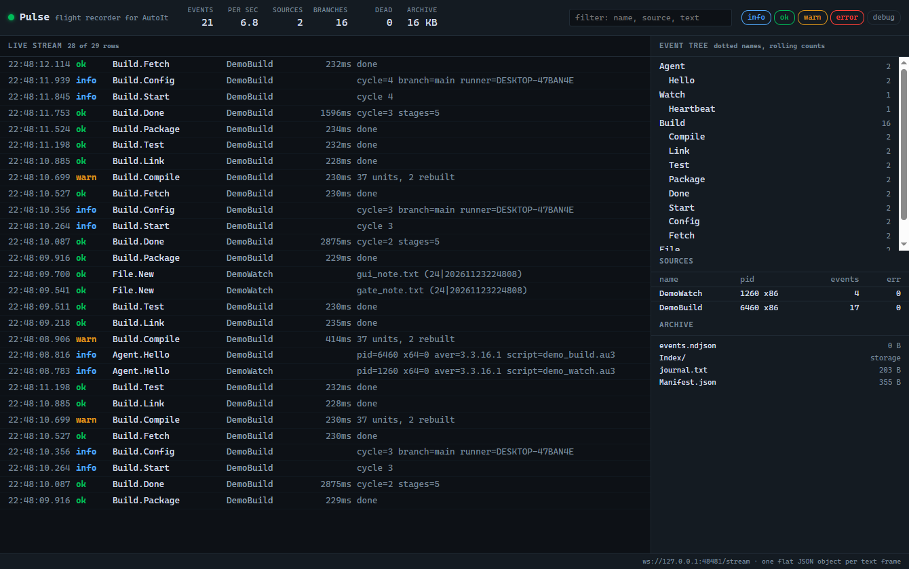

# Pulse

**Pulse 1.0.0** - a flight recorder and live console for AutoIt scripts on Windows.

[Download Pulse.zip](https://github.com/Numeric3/Pulse/releases/latest/download/Pulse.zip) |
[Changelog](CHANGELOG.md) |
[Protocol](docs/PROTOCOL.md) |
[Limits](docs/LIMITS.md)



A flight recorder and live console for AutoIt scripts. Start `Pulse.au3`, and every
script that includes `Pulse_Agent.au3` appears in a dashboard while it runs: the
event stream, a name index that knows that `Build.Compile.Step` belongs under
`Build.Compile`, per-process counts, and one `.cfb` file per session you can attach
to a ticket.

It is one AutoIt process that uses five UDFs at the same time, each for the job it is
actually good at:

| Layer | UDF | Job in Pulse |
| --- | --- | --- |
| transport | **WebSocket** | ingestion on `ws://127.0.0.1:48411/stream`, one text frame per event |
| routing | **WinEventManager** | the bus every event is posted on: four prioritised handlers count, record, colour and escalate; errors also go to the Windows Event Log |
| index | **Tree** | dotted event names as a trie with rolling subtree counts, exported into the archive |
| storage | **CompoundFile** | one `.cfb` per session holding journal, name index, ring tail and manifest |
| view | **WebView2** | the dashboard, served from local files on a virtual host, no network access |

Nothing here is a demo of those UDFs; each one is load-bearing. Remove Tree and the
branch panel loses its counts, remove CompoundFile and there is no archive to read
back, remove WinEventManager and the escalation path to the Event Log disappears.

---

## Quick start

```bat
:: 1. the console (a window opens and starts listening)
"C:\Program Files (x86)\AutoIt3\AutoIt3.exe" Pulse.au3

:: 2. an instrumented script, in another terminal
"C:\Program Files (x86)\AutoIt3\AutoIt3.exe" Examples\demo_build.au3

:: 3. the self test, no window and no second process
"C:\Program Files (x86)\AutoIt3\AutoIt3.exe" Pulse.au3 --auto
```

`RESULT ok=18 fail=0` on the last line is a pass. The whole suite, both bitnesses and
the live socket pairs, is `bash tests/gate.sh`.

## Instrumenting your own script

Two lines, and the script is a source in the console:

```autoit
#include "C:\path\to\Pulse\Pulse_Agent.au3"
_Pulse_Attach("NightlyBackup")

_Pulse_Send("Backup.Start", "share \\nas\backup")
_Pulse_Send("Backup.Done", "142 files", "ok", 38120) ; name, text, level, duration in ms
```

When a script already has the numbers in a Map, send the Map: every key becomes a
field on the row.

```autoit
Local $d[]
$d["files"] = 142
$d["bytes"] = 8123456
_Pulse_SendData("Backup.Scan", $d, "info", 4021)
```

The agent never throws and never blocks your work: if nothing is listening,
`_Pulse_Attach` costs one connect attempt (budget 1200 ms), retries at most once every
15 s — except during the first 20 s of the process, where the gap is 2 s so a script
launched next to a booting console still gets in — and every `_Pulse_Send` in between
returns False quietly. `--auto` on `Pulse_Agent.au3` runs its own seven checks over a
real socket.

## What you see

* **header** — events, events/s, sources, branches, dead letters, archive state.
* **live stream** — the last rows, coloured by level, with the filter box and the level
  chips above them. A row that was trimmed on the wire is marked.
* **name index** — the Tree, one line per dotted prefix, with the count of its whole
  subtree and the worst level beneath it. This is what makes "40 % of the run was
  `Build.Compile`" a fact rather than an estimate.
* **sources** — per process: events, errors, and the pid and bitness from its
  `Agent.Hello`.
* **archive** — the streams of the current `.cfb`, with sizes, so you can see the
  recorder working.

## The archive

One file per session: `out\Pulse_<session>_<bitness>.cfb`, where `bitness` is `x86` or `x64`.

```text
Sessions\<session>\Manifest.json    what ran, how long, how much, which bounds
Sessions\<session>\journal.txt      the bus's own account: POSTED / DISPATCHED / DEAD rows
Sessions\<session>\Index\tree.txt    TREE1 export of the name index, one row per node
Sessions\<session>\events.ndjson    the ring tail, one JSON object per line
```

`tests/readcfb.au3` opens a file as a stranger and checks all four:

```bash
bash tests/one.sh "<interpreter>" tests/readcfb.au3 "C:\...\out\Pulse_..._x86.cfb" DemoBuild DemoWatch
```

## Switches

| Switch | Effect |
| --- | --- |
| *(none)* | dashboard window + listener until you close the window |
| `--auto` | self test, 18 assertions, no window, no socket |
| `--headless` | listener and archive, no WebView2 |
| `--port N` | listen on another port (default 48411; the real port is printed at start-up) |
| `--seconds N` | stop by itself after N seconds |
| `--out DIR` | where the `.cfb`, the bus log and the WebView2 profile go (default `out`); resolved to a full path, because WebView2 refuses a relative profile folder |
| `--capture FILE` | write a PNG of the dashboard, once the page has said ready |
| `--grab-ms N` | earliest moment for that screenshot (default 12000); doubled if the page stays silent |

## Measured bounds

`Pulse.au3 --auto` prints this line first, so the table below cannot drift from the code:

```text
bounds ring=5000 perTurn=120 tree=20000 frame=8000 commitMs=5000 grabMs=12000
       uiRows=400 uiTicks=10 escalateMs=1000 treeRows=220 slots=8
```

| Bound | Value | What happens past it |
| --- | --- | --- |
| ring | 5000 rows | oldest rows are overwritten; the archive holds the tail |
| frames per connection per turn | 120 | the rest wait for the next turn, nothing is dropped |
| tree nodes | 20000 | past it, counts go to a plain Map and `overflow` says so |
| inbound frame | 8000 bytes | refused, counted in `rejected` |
| outbound frame (agent) | 4000 bytes | trimmed, row marked `truncated` |
| dashboard rows per push | 400 | older rows are in the archive, not on screen |
| archive flush | every 5000 ms | also on the `commit` message from the page |
| Event Log writes | at most 1 per 1000 ms | further errors are still in the ring |
| connections | 8 | the WebSocket UDF's own slot table |

Throughput, this machine, x86, headless, all four handlers and the journal on:
**5050 frames end to end in 8.0 s, about 630 events/s, none shed** (the same line
`--auto` prints). A build pipeline produces a few events per second; a loop that logs
every byte it reads will exceed this and the console will count what it lost instead of
hiding it.

## Repository layout

| Path | Purpose |
| --- | --- |
| `Pulse.au3` | Console, listener, bus, archive and dashboard host |
| `Pulse_Agent.au3` | Small include that instruments a host script |
| `Pulse_Json.au3` | Flat JSON codec used by the agent and console |
| `Web/` | Local dashboard HTML, CSS and JavaScript |
| `Lib/` | The five bundled Numeric1 UDFs and their MIT notice |
| `Examples/` | Build and file-watcher demo agents |
| `tests/` | Both-bitness gate, live pairs, dashboard checks and archive reader |
| `docs/` | Wire protocol, named limits and dashboard screenshot |

## Tests

```bash
bash tests/gate.sh          # everything; verdict in tests/out/gate_summary.txt
```

| Entry | Proves |
| --- | --- |
| `au3check …` (11 files) | every shipped file compiles clean with `-w 1` |
| `console_x86` / `console_x64` | the 18-assertion self test on both bitnesses |
| `agent_x86` / `agent_x64` | the agent over a real socket, including a closed port |
| `coexist_x86` / `coexist_x64` | all five UDFs loaded and callable in one process |
| `live_x86` / `live_x64` / `live_mixed` | console + two demo agents as three separate processes; the mixed pair is an x86 agent feeding an x64 console |
| `… archive reads back` | the `.cfb` of that live run, opened from outside, contains both sources by name |
| `nolisten_x86` / `nolisten_x64` | an instrumented script finishes normally when nothing is listening |
| `web syntax` / `web_dom` | the dashboard parses and its 10 regression checks cover escaping, filters, status, chips and the 800-row cap |

The dashboard tests need Node.js 18+; set `NODE` to its executable if it is not on
`PATH`. Pulse itself does not need Node.js. The gate also accepts `AI86`, `AI64` and
`AU3CHECK` overrides for another AutoIt installation. If the x64 interpreter is not
beside the x86 one or on `PATH`, set `AI64` explicitly; the gate never silently
substitutes x86 for x64.

AutoIt is never launched from inside AutoIt: measured here, a `Run()` of one `.au3`
from another produced a process that never executed, so every process in the live
entries is a direct child of the shell.

## Requirements

* AutoIt 3.3.16.1 (x86 and x64 both tested; Windows 10 19045).
* The WebView2 runtime for the dashboard. Without it the console logs
  `no WebView2 view …, continuing headless` and still records and archives.
* No admin rights: the Event Log entry is written by the bus and the self test asserts
  it succeeded unelevated.
* Node.js 18+ is only for the dashboard regression tests in `tests/gate.sh`, not for
  running Pulse.

## Security scope

Pulse is local instrumentation, not a remote monitoring service. The listener binds
to `127.0.0.1` only and uses plain WebSocket without TLS, authentication, Origin
validation or path validation. Any local process that can reach the port can post
events. Do not expose the port or treat an archive as proof of who produced an
entry. The complete bounds are in [docs/LIMITS.md](docs/LIMITS.md).

## Read next

* [docs/PROTOCOL.md](docs/PROTOCOL.md) - the frame format, field by field, and how to send from another language.
* [docs/LIMITS.md](docs/LIMITS.md) - what this does not do, said plainly.
* [CHANGELOG.md](CHANGELOG.md) - release history and measured checks.
* [THIRD_PARTY_NOTICES.md](THIRD_PARTY_NOTICES.md) - bundled component versions and credits.

Author: [Numeric1](https://github.com/Numeric3). Licence:
[MIT](https://github.com/Numeric3/Pulse/blob/main/LICENSE), Copyright (c) 2026 Numeric1.
The release ZIP intentionally omits the licence file; the repository and the bundled
UDF notices carry it.
